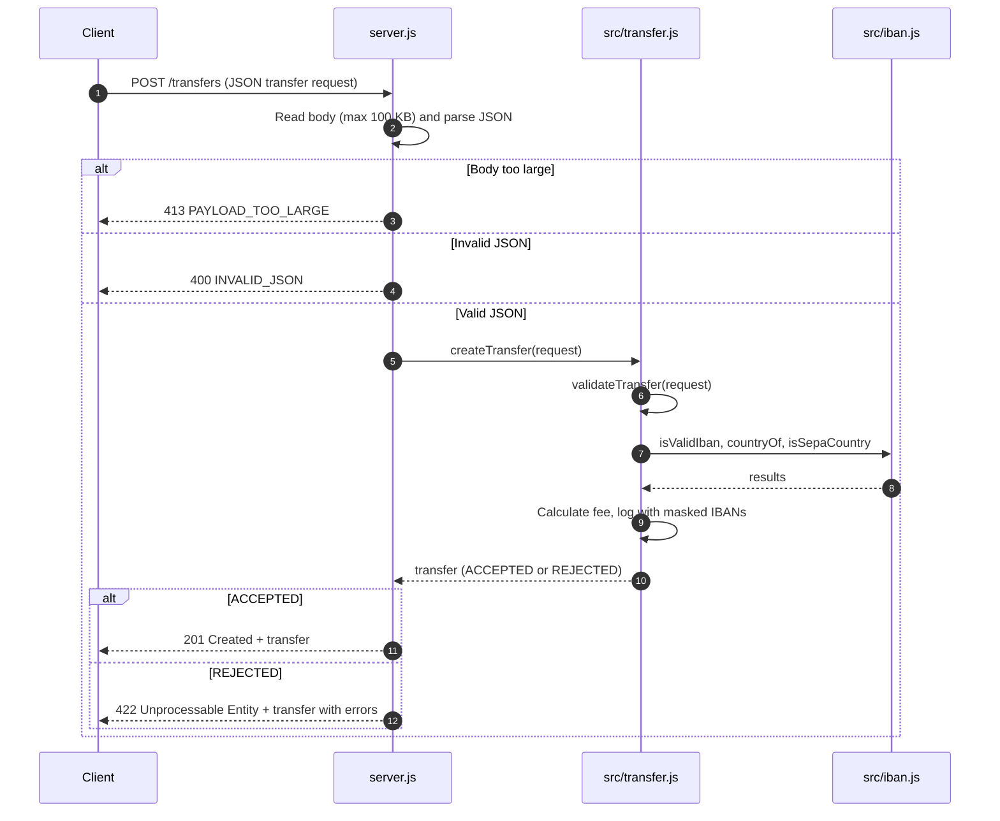

# Woodgrove Transfers API

A small HTTP API on top of `src/transfer.js`. It has no dependencies.

```bash
node server.js              # http://localhost:3000
PORT=8080 node server.js    # another port
```

All responses are JSON (`application/json; charset=utf-8`), except the transfer console at `/`. Amounts are integer euro cents: `12500` is € 125,00.

## Endpoints

| Method | Path | Purpose |
|---|---|---|
| `GET` | `/health` | Check that the service is running |
| `GET` | `/ibans/:iban` | Validate and format one IBAN |
| `POST` | `/transfers` | Create a transfer |
| `GET` | `/confluence/status` | Check the protected Confluence connection |
| `GET` | `/confluence/search?query=...` | Search Confluence pages |
| `GET` | `/confluence/pages/:id` | Read a Confluence page |
| `GET` | `/` | The transfer console (HTML) |

### Confluence Cloud read-only endpoints

Set `CONFLUENCE_BASE_URL` to your Atlassian site URL including `/wiki`, and configure `CONFLUENCE_EMAIL`, `CONFLUENCE_API_TOKEN`, and `CONFLUENCE_PROXY_API_KEY` in the server environment. Use a Confluence API token with read-only access. The proxy key is separate from the Atlassian token and is required on every `/confluence/` request:

```bash
curl -H "Authorization: Bearer $CONFLUENCE_PROXY_API_KEY" \
  http://localhost:3000/confluence/status
curl -G -H "Authorization: Bearer $CONFLUENCE_PROXY_API_KEY" \
  --data-urlencode "query=transfer guide" \
  http://localhost:3000/confluence/search
curl -H "Authorization: Bearer $CONFLUENCE_PROXY_API_KEY" \
  http://localhost:3000/confluence/pages/123456
```

The status response only reports whether the connection is configured and authenticated; it does not return the Atlassian account profile. Search results contain page IDs, titles, types, and space keys. Page reads return the page title, type, space key, and Confluence storage-format content.

| Route | Success response |
|---|---|
| `GET /confluence/status` | `{ "configured": true, "connected": true }` |
| `GET /confluence/search?query=transfer` | `{ "results": [{ "id": "123456", "title": "Transfer guide", "type": "page", "spaceKey": "OPS" }] }` |
| `GET /confluence/pages/123456` | `{ "id": "123456", "title": "Transfer guide", "type": "page", "spaceKey": "OPS", "content": "<p>...</p>" }` |

The search query must be 1–200 characters. Page IDs must contain only digits. Requests time out after 8 seconds. These routes return generic `502` errors when Confluence rejects credentials or is unavailable; upstream response details and credentials are not returned.

### GET /health

Returns `200` when the service is running.

```bash
curl http://localhost:3000/health
```

```json
{
  "status": "ok",
  "service": "woodgrove-transfers",
  "time": "2026-11-25T09:15:00.000Z"
}
```

### GET /ibans/:iban

Checks one IBAN. Spaces are allowed when URL-encoded (`%20`). Always returns `200` with `valid: true` or `valid: false`; returns `400 INVALID_REQUEST` when the URL can't be decoded.

```bash
curl http://localhost:3000/ibans/NL91%20ABNA%200417%201643%2000
```

```json
{
  "iban": "NL91ABNA0417164300",
  "formatted": "NL91 ABNA 0417 1643 00",
  "valid": true,
  "country": "NL",
  "sepa": true
}
```

| Field | Meaning |
|---|---|
| `iban` | The IBAN without spaces, in capitals |
| `formatted` | The IBAN in groups of four |
| `valid` | Format, length and check digits are correct |
| `country` | Two-letter country code |
| `sepa` | The country is in the SEPA area |

### POST /transfers

Creates a transfer from a JSON transfer request (at most 100 KB).

| Field | Type | Required | Meaning |
|---|---|---|---|
| `fromIban` | string | yes | Account to pay from |
| `toIban` | string | yes | Account of the beneficiary (SEPA only) |
| `beneficiaryName` | string | yes | Name of the beneficiary |
| `amountCents` | integer | yes | Amount in cents, 1 to 2500000 (€ 25.000,00) |
| `description` | string | no | At most 140 characters |
| `instant` | boolean | no | Instant transfer (fee 0.1%, min € 0,20, max € 2,50) |

```bash
curl -X POST http://localhost:3000/transfers \
  -H "Content-Type: application/json" \
  -d '{"fromIban":"NL20WGBK0123456789","toIban":"FR7630006000011234567890189","beneficiaryName":"Claire Dubois","amountCents":123456,"description":"Invoice 2026-114","instant":true}'
```

`201 Created` when the transfer is accepted:

```json
{
  "id": "TRF-20261125-0001",
  "status": "ACCEPTED",
  "errors": [],
  "fromIban": "NL20WGBK0123456789",
  "toIban": "FR7630006000011234567890189",
  "beneficiaryName": "Claire Dubois",
  "amountCents": 123456,
  "description": "Invoice 2026-114",
  "instant": true,
  "feeCents": 123,
  "createdAt": "2026-11-25T09:15:00.000Z"
}
```

`422 Unprocessable Entity` when the request is valid JSON but the transfer is rejected. The body is the same transfer object with `status: "REJECTED"` and every problem in `errors`:

```json
{
  "id": "TRF-20261125-0002",
  "status": "REJECTED",
  "errors": [
    { "code": "SAME_ACCOUNT", "message": "You cannot transfer money to the account it comes from." },
    { "code": "INVALID_AMOUNT", "message": "Enter an amount greater than zero." }
  ],
  "fromIban": "NL20WGBK0123456789",
  "toIban": "NL20WGBK0123456789",
  "beneficiaryName": "Jan de Vries",
  "amountCents": 0,
  "description": "",
  "instant": false,
  "feeCents": 0,
  "createdAt": "2026-11-25T09:16:00.000Z"
}
```

## Errors

HTTP errors have this shape:

```json
{ "error": { "code": "INVALID_JSON", "message": "The request body must be a JSON transfer request." } }
```

| Code | Where | HTTP status | Meaning |
|---|---|---|---|
| `INVALID_FROM_IBAN` | transfer `errors` | 422 | `fromIban` is not a valid IBAN |
| `INVALID_TO_IBAN` | transfer `errors` | 422 | `toIban` is not a valid IBAN |
| `NON_SEPA_COUNTRY` | transfer `errors` | 422 | `toIban` is outside the SEPA area |
| `SAME_ACCOUNT` | transfer `errors` | 422 | `fromIban` and `toIban` are the same account |
| `MISSING_BENEFICIARY_NAME` | transfer `errors` | 422 | `beneficiaryName` is missing or empty |
| `INVALID_AMOUNT` | transfer `errors` | 422 | `amountCents` is not a positive integer |
| `AMOUNT_TOO_HIGH` | transfer `errors` | 422 | `amountCents` is above 2500000 (€ 25.000,00) |
| `DESCRIPTION_TOO_LONG` | transfer `errors` | 422 | `description` is longer than 140 characters |
| `INVALID_JSON` | `error` | 400 | The body of `POST /transfers` is not valid JSON |
| `INVALID_REQUEST` | `error` | 400 | The IBAN in `GET /ibans/:iban` is not URL-encoded correctly |
| `UNAUTHORIZED` | `error` | 401 | A valid `CONFLUENCE_PROXY_API_KEY` bearer token is required |
| `NOT_FOUND` | `error` | 404 | No such route or file |
| `METHOD_NOT_ALLOWED` | `error` | 405 | `/transfers` only accepts `POST` |
| `PAYLOAD_TOO_LARGE` | `error` | 413 | The request body is larger than 100 KB |
| `CONFLUENCE_NOT_CONFIGURED` | `error` | 503 | Confluence credentials are not configured |
| `CONFLUENCE_PROXY_NOT_CONFIGURED` | `error` | 503 | The proxy key is not configured |
| `CONFLUENCE_AUTH_FAILED` | `error` | 502 | Confluence rejected the configured credentials |
| `CONFLUENCE_UNAVAILABLE` | `error` | 502 | Confluence could not be reached |
| `INTERNAL_ERROR` | `error` | 500 | Unexpected error; details are logged on the server only |

## POST /transfers step by step


